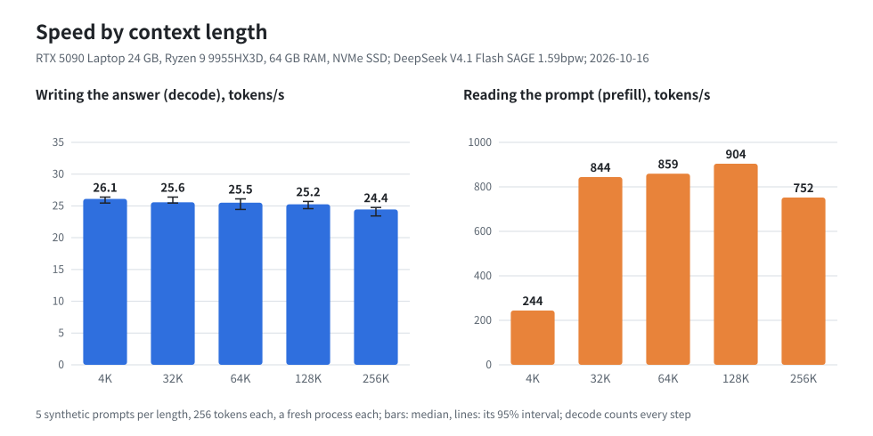
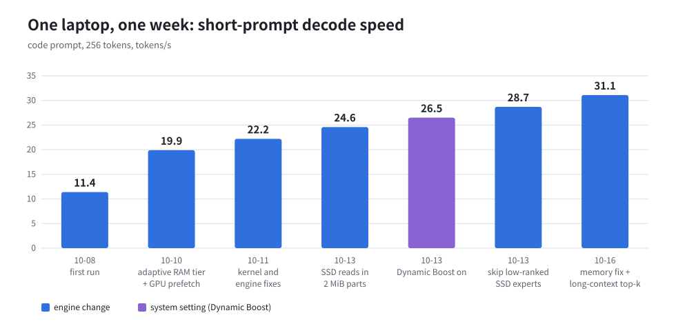

# DeepSeek V4.1 Flash on a 64 GB laptop

DeepSeek V4.1 Flash is a 763B-parameter mixture-of-experts model (with its Engram memory). Strata runs its SAGE
1.59bpw quantization on a gaming laptop with an RTX 5090 Laptop GPU (24 GB) and 64 GB of RAM. It writes about
**30 tokens/s** on short prompts right after a start, **32-39 tokens/s** through the API once the server runs, and
**23.6 tokens/s** with a 256K-token prompt.

This page is the whole recipe: the laptop, the steps, the settings that matter, what they cost in quality, and every
number with its raw data ([ds41/bench/results/2026-10-15-laptop-5090](../ds41/bench/results/2026-10-15-laptop-5090)).

<p align="center"></p>

## What you get

Measured on 2026-10-15 on the laptop below, source commit `adad2779` (the API server also had `7b79a3e0`).
Each run: a fresh start, one prompt, 256 tokens written. "Decode" is the mean over all 256 steps; the slow steps
(stalls, see [Known limits](#known-limits)) count.

| Prompt | Reads the prompt (prefill) | Writes the answer (decode) |
| --- | ---: | ---: |
| 4K tokens (2 prompts) | 180 tokens/s (23 s) | 25.1 tokens/s |
| 32K tokens (2 prompts) | 734 tokens/s (45 s) | 24.8 tokens/s |
| 64K tokens (2 prompts) | 822 tokens/s (80 s) | 25.0 tokens/s |
| 128K tokens (2 prompts) | 841 tokens/s (2.6 min) | 24.4 tokens/s |
| 256K tokens (1 prompt) | 650 tokens/s (6.7 min) | 23.6 tokens/s |

Short chat prompts (50-330 tokens), 2 rounds each:

| Prompt | Decode, tokens/s |
| --- | ---: |
| agent: a coding agent with a tool, 328 tokens | 29.6 |
| code: write an LRU cache class with tests, 57 tokens | 30.5 |
| zh_chat: plan a week in Japan (Chinese), 51 tokens | 30.6 |
| en_explain: explain attention, 51 tokens | 29.6 |

Through the API, the way an app uses it (`serve/server.py` with the flags setup writes, streamed OpenAI requests,
up to 512 tokens, timed by the client from the first token to the last):

| Request | Prompt tokens | Time to first token | Decode, tokens/s |
| --- | ---: | ---: | ---: |
| English question, round 1 (prompt cached by the warm-up) | 63 | 0.0 s | 35.6 |
| Chinese question, round 1 | 54 | 1.6 s | 39.1 |
| coding task, round 1 | 64 | 2.1 s | 34.0 |
| English question, round 2 | 63 | 2.1 s | 35.2 |
| Chinese question, round 2 | 54 | 1.8 s | 38.2 |
| coding task, round 2 | 64 | 2.1 s | 32.2 |
| summarize an 18K-token source file, round 1 | 18,062 | 33.0 s | 31.8 |

Why the API is faster than the table above: each `ds41_generate` run starts a fresh process. Its first 32 steps take
about 54 ms each, because the experts in GPU memory and the RAM tier are still cold; steps 129-255 take 28-30 ms
(33-36 tokens/s). A server that is already running keeps them warm. The model thinks before it answers (thinking is
on by default), so 512 tokens is mostly its reasoning.

## The laptop

| Part | This laptop |
| --- | --- |
| GPU | NVIDIA GeForce RTX 5090 Laptop GPU, 24 GB, PCIe 5.0, driver 610.57 |
| CPU | AMD Ryzen 9 9955HX3D, 16 cores / 32 threads |
| RAM | 64 GB (60.5 GiB usable) |
| SSD | 2 TB NVMe (YMTC PC411) |
| OS | Linux (Arch-based, kernel 7.1), CUDA 13.3 |

Other laptops are not tested. The GPU's memory (24 GB) and the RAM (64 GB) decide the most; a slower SSD makes the
first steps after a start slower.

## How a 763B model fits

The pack has 10.6 GB of dense weights and 108.9 GB of experts (384 in each of 40 layers, 15,360 in all; each
token uses 6 per layer). The Engram tables (about 196 GB) stay in the source files on the SSD; each token reads a
few rows.

| Where | What | Size on this laptop |
| --- | --- | --- |
| GPU memory | dense weights, KV cache, the experts every prompt uses most | about 1,650 experts (12 GiB) |
| RAM | the RAM tier: the next most used experts; it adapts while it answers | about 6,500 experts (46 GiB, locked) |
| SSD | everything else, read when a token needs it | 4-6 experts per token |

## Steps

1. **Turn on Dynamic Boost.** On this laptop the GPU was held at 95 W of its 175 W because `nvidia-powerd` was off.
   With it on, decode is 7-9% faster:

   ```sh
   sudo systemctl enable --now nvidia-powerd
   ```

2. **Install** (Linux, NVIDIA, about 462 GB of free disk: 342 GB download plus a 120 GB pack). Setup warns that a PC
   with less than 120 GiB of RAM is not tested; `--yes` accepts that:

   ```sh
   ./setup.sh --setup --yes --family deepseek --context 32768 --no-start
   ```

   It downloads `vcruz305/DSV4.1-Flash-SAGE-EXL3-1.59bpw` (pinned revision), builds `ds41_serve` from source and
   writes the pack. Details: [MODELS.md](MODELS.md#deepseek-v41-flash-sage-159bpw).

3. **Start** the server (OpenAI and Anthropic API on `127.0.0.1:8080`):

   ```sh
   ./run-deepseek-sage-1.59bpw.sh
   ```

   Each start fills and locks the RAM tier: about 20 s after the model loads (36 s in 1 of 17 runs).

What was run where: the setup flow itself was tested on a 128 GB PC (2026-10-07). On this laptop the model was
fetched at the same revision and packed with `tools/ds41/pack.py` (the packer setup runs), and `serve/server.py`
was started with the exact engine flags setup writes (`serve-config.json` in the raw data).

## Settings that matter

All of these are on by default. Each was measured on this laptop before it became a default.

| Setting | What it does | Measured effect | Off |
| --- | --- | --- | --- |
| Adaptive RAM tier | an expert read from the SSD stays in a free RAM slot; the least used leave between steps | code 11.4 -> 19.9 tokens/s (with the GPU prefetch) | `DS41_RAM_ADAPT=0` |
| GPU prefetch | the next layer's likely experts are copied to the GPU while this layer computes | code 52.2 -> 49.6 ms/token | (with the adaptive tier) |
| Route tail skip | an expert outside GPU memory that every token routes at rank 5 or 6 of 6 is left out | (upstream's rule) | `DS41_ROUTE_TAIL_SKIP=0` (both skips) |
| SSD tail skip | an expert that would be read from the SSD and that every token routes at rank 4-6 is left out | code 37.8 -> 34.9 ms/token | `DS41_SSD_TAIL_SKIP=0` |
| Long-context top-k | the indexer's top-512 selection runs on all the GPU's cores from 8,192 keys | 256K 45.6 -> 41.9 ms/token | (always) |

## What it costs

The two tail skips leave out a few low-ranked experts, so the output is not exactly the full model's. Teacher-forced
negative log-likelihood (lower is better) on two fixed texts:

| | code | agent |
| --- | ---: | ---: |
| no skips | 1.257 | 1.670 |
| route tail skip | 1.263 | 1.658 |
| route + SSD tail skip (default) | 1.269 | 1.644 |

On code the defaults cost +0.012 (about 1%); on the agent text they measured no loss. This comes on top of the
1.59bpw quantization's own loss, which this page does not measure.

## How it got here

<p align="center"></p>

Each bar was measured right after the change, on the same `code` prompt, 256 tokens. The early bars used the
measuring tools of their day (fixed continuations), so the steps are close but not exactly comparable.

## Known limits

- **Stalls.** In 256 tokens, 1-3 steps take over 100 ms (the mean step: 33-42 ms). In these runs 36 of the 37
  stalls came in the first 32 steps after a start, while the GPU's and the RAM tier's experts are still cold and a
  step reads many experts from the SSD. They cost about 1 token/s in the means above; a running server has few.
- **Prompts.** Long prompts read at 650-850 tokens/s: a 256K-token prompt takes about 6.7 minutes before the first
  token. A prompt part of up to 120 tokens (a new chat turn) is read at about 30 tokens/s (about 2 s for 60 tokens).
  Prompts of a few thousand tokens read slowest per token: 4K tokens at 180 tokens/s (23 s), because a prefill pass
  streams every expert outside GPU memory once, however short the prompt.
- **Memory.** The process holds about 54 GiB of the 60.5 GiB. Other large programs running at the same time make it
  slower.
- **Not tested:** other laptops, 32 GB of RAM, Windows, AMD GPUs.

## Raw data

[ds41/bench/results/2026-10-15-laptop-5090](../ds41/bench/results/2026-10-15-laptop-5090): the machine, every run's
summary and per-step timings, the API requests, the full test run, and the scripts and prompts to repeat it.
