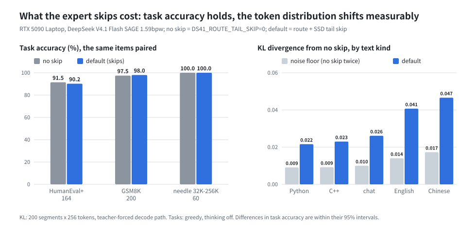

# DeepSeek V4.1 Flash on a 64 GB laptop

DeepSeek V4.1 Flash is a 763B-parameter mixture-of-experts model (with its Engram memory). Strata runs its SAGE
1.59bpw quantization on a gaming laptop with an RTX 5090 Laptop GPU (24 GB) and 64 GB of RAM. Measured on
2026-10-16, five runs per condition, medians:

- **30-32 tokens/s** on short prompts right after a start, and **33-39 tokens/s** through the API once the server
  runs; **37.6 tokens/s** over 30 minutes of continuous generation, with no slowdown.
- **24.4 tokens/s** with a 256K-token prompt (95% interval 23.4-24.8).
- The settings that make it fast leave out a few low-ranked experts. Task accuracy stays within its noise (HumanEval+
  91.5% -> 90.2%, GSM8K 97.5% -> 98.0%, needle in a haystack 60 of 60 both); the token distribution shifts
  measurably, most on Chinese prose. See [What it costs](#what-it-costs).

This page is the whole recipe: the laptop, the steps (repeated from scratch on 2026-10-16), the settings, what they
cost, where the time goes, how it was measured, and every number's raw data in
[ds41/bench/results/2026-10-16-laptop-5090](../ds41/bench/results/2026-10-16-laptop-5090).

<p align="center"></p>

## What you get

**A fresh start, one prompt.** Each run is a new `ds41_generate` process (cold GPU and RAM tiers), 256 tokens written,
5 prompts per condition in one shuffled order. Decode counts every step, the slow ones too. Interval: 95% bootstrap
interval of the median.

| Prompt | Reads the prompt (prefill), median | Writes the answer (decode), median [95% interval] | Step time p50 / p95 / p99 |
| --- | ---: | ---: | ---: |
| short chat prompts (51-328 tokens), 4 kinds x 5 | - | 30.0-32.0 tokens/s | 27-30 / 55-57 / 76-92 ms |
| 4K tokens | 244 tokens/s (17 s) | 26.1 [25.5, 26.4] tokens/s | 36 / 57 / 95 ms |
| 32K tokens | 844 tokens/s (39 s) | 25.6 [25.5, 26.4] tokens/s | 37 / 58 / 94 ms |
| 64K tokens | 859 tokens/s (76 s) | 25.5 [24.5, 26.1] tokens/s | 36 / 59 / 84 ms |
| 128K tokens | 904 tokens/s (2.4 min) | 25.2 [24.6, 25.7] tokens/s | 37 / 59 / 89 ms |
| 256K tokens | 752 tokens/s (5.8 min) | 24.4 [23.4, 24.8] tokens/s | 38 / 60 / 109 ms |

Short prompts by kind, decode median [95% interval]: agent (a coding agent with a tool, 328 tokens) 30.0 [29.4, 31.3],
code (an LRU cache class, 57 tokens) 31.2 [29.9, 32.9], en_explain (51 tokens) 30.6 [30.3, 30.9], zh_chat (51 tokens)
32.0 [31.9, 32.3].

**Through the API, server already running** (the server setup writes, 32K context; streamed OpenAI requests, thinking
on, up to 512 tokens; 5 requests each, shuffled; timed by the client):

| Request | Prompt tokens | Time to first token, median | Decode, median [95% interval] | Gap between tokens p50 / p95 / p99 |
| --- | ---: | ---: | ---: | ---: |
| Chinese question | 54 | 1.8 s | 39.3 [37.7, 40.7] tokens/s | 24 / 36 / 44 ms |
| English question | 63 | 2.2 s | 37.2 [35.7, 40.5] tokens/s | 25 / 38 / 50 ms |
| coding task | 64 | 2.1 s | 33.2 [32.3, 34.5] tokens/s | 28 / 46 / 63 ms |
| summarize an 18K-token source file | 18,062 | 31.5 s | 34.7 [32.0, 37.6] tokens/s | 27 / 43 / 54 ms |

A repeated prompt hits the server's prompt cache (first token in 0.05-0.13 s); the medians are uncached.

**30 minutes without a pause** (32 requests of 2,048 tokens back to back): decode median 37.6 tokens/s; the first five
requests 38.3, the last five 38.0. The GPU drew 165 W on average at 83 °C (84 °C at most), SM clock 2,418 MHz; in 83%
of the 1-second samples it ran at its software power limit (175 W), never at a thermal limit. CPU 85 °C. GPU energy:
4.6 J per token (the CPU's power is not readable without root on this laptop, so it is not included).

Why the API is faster than a fresh start: in a new process the first 32 steps take about 54 ms each while the experts
in GPU memory and the RAM tier are still cold; later steps take 28-30 ms. Of the 77 steps over 100 ms in the 45 fresh
starts, 75 came in the first 32 steps. A running server keeps the tiers warm.

## The laptop

| Part | This laptop |
| --- | --- |
| GPU | NVIDIA GeForce RTX 5090 Laptop GPU, 24 GB, PCIe 5.0 x8 (28.9 GB/s measured), driver 610.57, 175 W limit |
| CPU | AMD Ryzen 9 9955HX3D, 16 cores / 32 threads |
| RAM | 64 GB (60.5 GiB usable), 59.9 GB/s measured read |
| SSD | 2 TB NVMe (YMTC PC411), 5.35 GB/s measured for expert-sized random reads |
| OS | Linux (Arch-based, kernel 7.1), CUDA 13.3, BIOS N.1.18MRO43 |

Other laptops are not tested. The GPU's memory (24 GB) and the RAM (64 GB) decide the most; a slower SSD makes the
first steps after a start slower.

## How a 763B model fits

The pack has 10.6 GB of dense weights and 108.9 GB of experts (384 in each of 40 layers, 15,360 in all; each
token uses 6 per layer). The Engram tables (about 196 GB) stay in the source files on the SSD; each token reads a
few rows.

| Where | What | On this laptop |
| --- | --- | --- |
| GPU memory | dense weights, KV cache, the experts every prompt uses most | about 1,650 experts (12 GiB) |
| RAM | the RAM tier: the next most used experts; it adapts while it answers | about 6,500 experts (46 GiB, locked) |
| SSD | everything else, read when a token needs it | 3-5 experts per token |

**Where the time goes** (a short prompt, steps 33-256; the lower bound is the bytes a token moves through that part
at the bandwidth measured on this laptop):

| Part | Bytes per token | Lower bound | Measured |
| --- | ---: | ---: | ---: |
| GPU memory: dense weights and the ~159 experts in VRAM | 10.4 GB | 13.3 ms | 14.7 ms (GPU wait) |
| RAM: the ~27 experts the CPU computes | 0.19 GB | 3.2 ms | 7.5 ms |
| SSD: ~3 experts read | 0.02 GB | 4.2 ms | 5.1 ms |
| PCIe: ~17 experts prefetched to the GPU | 0.12 GB | 4.1 ms | runs beside the GPU's work |

A step took 29.3 ms. The GPU part is within about 10% of its memory bandwidth (the dense bytes are counted as stored;
some are read in a smaller FP8 copy, so the true margin is somewhat larger). The CPU experts run at about 43% of RAM
bandwidth: the CPU's arithmetic, not memory, limits them. With a 256K prompt the CPU computes ~40 experts per token
(11.9 ms against a 4.7 ms bound) and the step takes 38.2 ms. An nsys trace of 63 decode steps shows the GPU fully
idle 1.6 ms per token, almost all of it between steps.

## Steps

1. **Turn on Dynamic Boost.** On this laptop the GPU was held at 95 W of its 175 W because `nvidia-powerd` was off.
   With it on, decode is 7-9% faster:

   ```sh
   sudo systemctl enable --now nvidia-powerd
   ```

2. **Install** (Linux, NVIDIA, about 462 GB of free disk: 342 GB download plus a 120 GB pack). Setup warns that a PC
   with less than 120 GiB of RAM is not tested; `--yes` accepts that:

   ```sh
   ./setup.sh --setup --yes --family deepseek --context 32768 --no-start
   ```

   It downloads `vcruz305/DSV4.1-Flash-SAGE-EXL3-1.59bpw` (pinned revision), builds `ds41_serve` from source and
   writes the pack. Details: [MODELS.md](MODELS.md#deepseek-v41-flash-sage-159bpw).

3. **Start** the server (OpenAI and Anthropic API on `127.0.0.1:8080`):

   ```sh
   ./run-deepseek-sage-1.59bpw.sh
   ```

**Repeated from scratch on 2026-10-16** on this laptop: a fresh clone in a new folder, only the commands above (step 1
was already on). Setup took 3 hours: the engine build 1 minute, the download 2 h 57 min (setup reads one file at a
time; about 32 MB/s here), the pack 2 min 14 s. The pack it wrote is byte for byte the development pack (sha256 of
every file, except `engram.txt`, which holds absolute paths). The start script answered on port 8080 after 28 s and
gave its first answer 35 s after the start. Hashes of the model files, the pack and the binaries:
[install/sha256.txt](../ds41/bench/results/2026-10-16-laptop-5090/install/sha256.txt).

## Settings that matter

All of these are on by default. Each was measured on this laptop before it became a default.

| Setting | What it does | Measured effect | Off |
| --- | --- | --- | --- |
| Adaptive RAM tier | an expert read from the SSD stays in a free RAM slot; the least used leave between steps | code 11.4 -> 19.9 tokens/s (with the GPU prefetch) | `DS41_RAM_ADAPT=0` |
| GPU prefetch | the next layer's likely experts are copied to the GPU while this layer computes | code 52.2 -> 49.6 ms/token | (with the adaptive tier) |
| Route tail skip | an expert outside GPU memory that every token routes at rank 5 or 6 of 6 is left out | decode 44.8 -> 28.7 ms/step together with the SSD tail skip (200 x 256 tokens) | `DS41_ROUTE_TAIL_SKIP=0` (both skips) |
| SSD tail skip | an expert that would be read from the SSD and that every token routes at rank 4-6 is left out | code 37.8 -> 34.9 ms/token | `DS41_SSD_TAIL_SKIP=0` |
| Long-context top-k | the indexer's top-512 selection runs on all the GPU's cores from 8,192 keys | 256K 45.6 -> 41.9 ms/token | (always) |

## What it costs

The defaults leave out a few low-ranked experts (the route tail skip, upstream's rule, and the SSD tail skip), so the
output is not exactly what the same quantized model computes with every expert. This was measured three ways on this
laptop, each time against the same engine with the skips off (`DS41_ROUTE_TAIL_SKIP=0`). It does not compare against
the full-precision model: the official checkpoint (510 GB) needs data-center GPUs, so the 1.59bpw quantization's own
loss is not measured here.

<p align="center"></p>

**Tasks** (greedy, thinking off, the same items paired; code run in an offline sandbox):

| Task | No skip | Default | Difference (95% interval) | Exact McNemar p |
| --- | ---: | ---: | ---: | ---: |
| HumanEval+ (164) | 91.5% | 90.2% | -1.2 points [-3.7, +1.2] | 0.63 |
| HumanEval base tests (164) | 95.7% | 95.1% | -0.6 points [-2.4, +1.2] | 1.0 |
| GSM8K (first 200 of test) | 97.5% | 98.0% | +0.5 points [0.0, +1.5] | 1.0 |
| Needle in a haystack, 32K-256K x depth 10/50/90% (60) | 60 of 60 | 60 of 60 | 0 | |

The skips act in decode only (a batched prefill computes every expert), so the needle test compares the answer
tokens after the same long prompt. Its 60 prompts hide a 7-digit code in this repository's docs and sources (the
needle's words checked absent from the haystack), 5 per length and depth.

**Token distributions.** 200 segments of 256 tokens (code, English, Chinese, chat), fed token by token through the
decode path (teacher forcing), every position's distribution saved. KL divergence from the no-skip run, and how often
the most likely token is the same. The noise floor is a second no-skip run: which experts sit in GPU memory or RAM
decides whether the GPU or the CPU (int8 activations) computes them, so two runs differ even without skips.

| | KL divergence, mean (95% interval) | Same top token | Mean NLL change |
| --- | ---: | ---: | ---: |
| noise floor (no skip, run twice) | 0.0119 [0.0111, 0.0129] | 94.9% | +0.002 |
| route tail skip only | 0.0295 [0.0276, 0.0314] | 92.0% | +0.020 |
| default (route + SSD tail skip) | 0.0316 [0.0295, 0.0337] | 91.8% | +0.020 |

The cost is not even across text: code moves least (KL 0.022, 94% same top token), Chinese prose most (KL 0.047,
87%; its noise floor 0.017, 92%). Nearly all of it comes from the route tail skip; the SSD tail skip adds little.
In return the skips make decode faster: in the same runs a step took 44.8 ms without skips and 28.7 ms with them.
To turn both off: `DS41_ROUTE_TAIL_SKIP=0` in the server's environment.

**Reading.** 20 outputs picked at random (10 HumanEval+, 10 GSM8K, defaults) were read in full: no repetition, no
garbled text, no switch of language.

## How it got here

<p align="center"></p>

Each bar was measured right after the change, on the same `code` prompt, 256 tokens. The early bars used the
measuring tools of their day (one or two runs, some with fixed continuations); the last bar is the median of five.

## Method and limits

- **Runs.** Speed: 5 runs per condition, one shuffled order (a fixed seed), a fresh process per cold run, the page
  cache of the pack dropped before each. Quality: one run per setting, plus a second no-skip run as the noise floor.
  Intervals: bootstrap (10,000 resamples) of the median over runs, or of the mean over items or segments.
- **Decision rules written first.** The rules for "clearly worse" were written before the task and needle results
  existed ([criteria.md](../ds41/bench/results/2026-10-16-laptop-5090/quality/criteria.md)); the KL rule was written
  after the first KL result was seen. None was met.
- **Hardware samples** every second: GPU power, temperature, clock and throttle reasons, CPU temperature and clock,
  memory pressure ([speed/tele.tsv](../ds41/bench/results/2026-10-16-laptop-5090/speed/tele.tsv)).
- **One incident.** A first batch of default-setting evals reached the no-skip server, because the previous server
  outlived its script; the 6 answers it produced were discarded, and every later server was checked from its own
  log to run the intended setting.
- **Not measured:** the full-precision model (the official checkpoint needs data-center GPUs), so the 1.59bpw
  quantization's own loss is unknown here; other laptops; quality with thinking on; the CPU's power.
- **Prompts.** Long prompts read at 750-900 tokens/s; a 256K-token prompt takes about 6 minutes before the first
  token. A prompt part of up to 120 tokens (a new chat turn) is read at about 30 tokens/s. A prompt of a few thousand
  tokens reads slowest per token (4K tokens in 17 s), because a prefill pass streams every expert outside GPU memory.
- **Memory.** The process holds about 54 GiB of the 60.5 GiB. Other large programs running at the same time make it
  slower.
- **No other runtime to compare with.** On 2026-10-15 no other runtime ran DeepSeek V4.1 Flash on 24 GB of VRAM and
  64 GB of RAM: llama.cpp converts it but cannot load it yet, ktransformers supports V4-Flash with at least 200 GB of
  RAM ([baseline.md](../ds41/bench/results/2026-10-16-laptop-5090/baseline.md)).
- **No third-party reproduction yet.** All numbers here come from one laptop.

## Repeat it on your PC

A result from another PC (any NVIDIA GPU with 24 GB or more and 64 GB of RAM or more) tells others what to expect.
Upstream's [community benchmark guide](COMMUNITY_BENCHMARKS.md) describes what to record; for this model:

1. Install with the [steps](#steps). Note the GPU, its power limit (`nvidia-smi -q -d POWER`), the PCIe link
   (`nvidia-smi --query-gpu=pcie.link.gen.current,pcie.link.width.current --format=csv`), the CPU, the RAM, the SSD,
   the driver, CUDA, the OS and the Strata commit (`git log --oneline -1`). Compare your pack with
   [install/sha256.txt](../ds41/bench/results/2026-10-16-laptop-5090/install/sha256.txt).
2. Start the server and send the same requests as this page, five times each:

   ```sh
   R=ds41/bench/results/2026-10-15-laptop-5090; S=ds41/bench/results/2026-10-16-laptop-5090/scripts
   python3 -c "import json; [open('p_%s.txt' % k, 'w').write(v) for k, v in json.load(open('$R/api-prompts.json')).items() if k != 'about']"
   for r in 1 2 3 4 5; do for p in en zh code long; do
     python3 $S/api_stream.py http://127.0.0.1:8080 my-api.jsonl $p-r$r p_$p.txt 512
   done; done
   ```

   Each line of `my-api.jsonl` has the time to first token, the decode tokens/s and the gaps of one request.
3. Optional: the whole protocol, [scripts/d1.sh](../ds41/bench/results/2026-10-16-laptop-5090/scripts/d1.sh), with its
   paths set to your install.
4. Share it: an issue or a pull request with `ds41/bench/results/<date>-community-<gpu>/` holding a README (hardware,
   software, settings, the median and range of each request), `my-api.jsonl` and the server log.

## Raw data

[ds41/bench/results/2026-10-16-laptop-5090](../ds41/bench/results/2026-10-16-laptop-5090): every run's summary and
per-step timings, the API requests with their text, the hardware samples, the bandwidths, the nsys summary, the
roofline, the quality data (KL divergence, every eval answer, the needle answers), the clean install's logs and
hashes, and every script. The earlier single-run measurements of 2026-10-15:
[ds41/bench/results/2026-10-15-laptop-5090](../ds41/bench/results/2026-10-15-laptop-5090).
