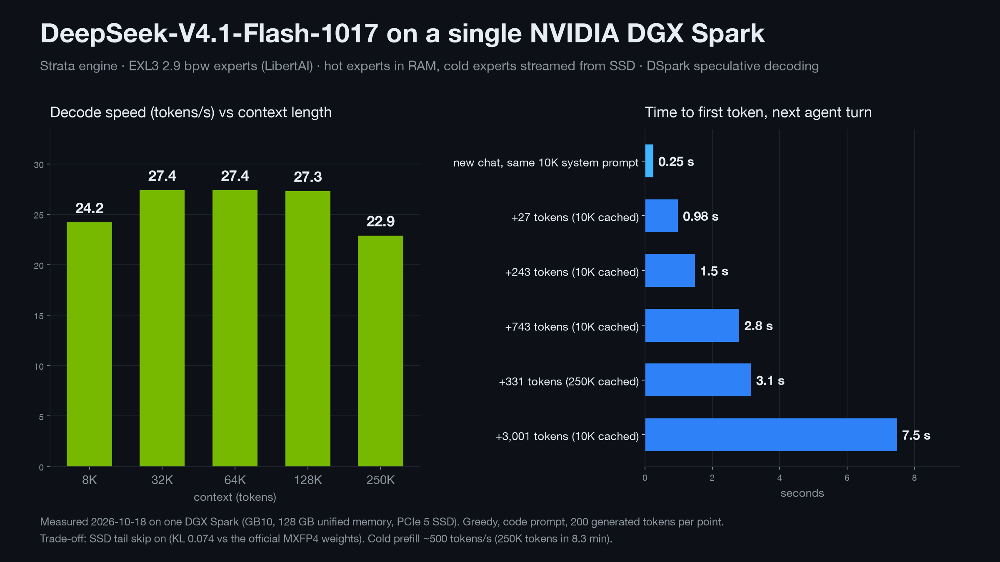

# DeepSeek V4.1 Flash 1017 on a DGX Spark

DeepSeek V4.1 Flash 1017 is DeepSeek's 763B mixture-of-experts model (with its Engram memory), the release of
2026-10-17. Strata runs it on one NVIDIA DGX Spark (GB10, 128 GB of unified memory) with LibertAI's EXL3 2.9 bpw
experts: the most used experts stay in memory, the rest are read from the SSD when a token needs them.

Measured on 2026-10-18 on one DGX Spark:

- **30.8 tokens/s** over a real coding-agent session: 48 turns of an agent client (DeepSeek Harness), 70,211 tokens
  written, the context growing from 10K to 91K
  tokens. Per turn 23.6-36.4 tokens/s, median 28.6. Code and file writing run fastest.
- **About 1 s to the first token** of an agent turn that adds up to 50 tokens (a tool result), 1.3 s for 51-150 tokens.
- **22.9 tokens/s with a 250K-token context.** The server is set up for 256K tokens.
- Quality: against the official MXFP4 weights (the checkpoint DeepSeek published), KL divergence 0.074 and the same
  top token 88.6% of the time. See [What it costs](#what-it-costs).

Most numbers on this page are single runs (the laptop recipe, [DEEPSEEK_LAPTOP.md](DEEPSEEK_LAPTOP.md), has five
runs per condition). Raw data: [ds41/bench/results/2026-10-18-spark](../ds41/bench/results/2026-10-18-spark).

<p align="center"></p>

## What you get

**A coding-agent session.** The installed server (the settings setup writes), an agent client doing real work in
this repository, 2026-10-18. Every turn after the first reuses the conversation so far; the times are the engine's
own (the server log).

| | Value |
| --- | ---: |
| turns (after the first) | 48 |
| context | 10,310 - 91,310 tokens |
| tokens written | 70,211 |
| decode, all tokens | 30.8 tokens/s |
| decode per turn, min / median / max | 23.6 / 28.6 / 36.4 tokens/s |
| DSpark drafts accepted | 84.2% (2.97 tokens per verify pass) |

Time to read a turn's new tokens (the time to the first token, without the client's own time):

| New tokens in the turn | Turns | Median | Most |
| --- | ---: | ---: | ---: |
| 1-50 | 7 | 0.57 s | 1.15 s |
| 51-150 | 28 | 1.27 s | 1.65 s |
| 151-500 | 8 | 1.84 s | 2.32 s |
| 501-1,500 | 2 | 2.79 s | 3.09 s |
| 1,501-5,000 | 2 | 8.43 s | 10.60 s |
| 10,007 (the client sent back a 10K-token answer without its thinking, so the cache matched only up to it) | 1 | 24.96 s | |

**Decode by context length** (one run each, a code prompt, 200 tokens written, `ds41_serve` with the setup's
settings):

| Context | Decode |
| --- | ---: |
| 8K | 24.2 tokens/s |
| 32K | 27.4 tokens/s |
| 64K | 27.4 tokens/s |
| 128K | 27.3 tokens/s |
| 250K | 22.9 tokens/s (20.8 over 300 tokens in a second run) |

**Time to the first token** (one run each, a 10,000-token context already read):

| Request | Time |
| --- | ---: |
| a new conversation with the same 10,000-token system prompt (root checkpoint) | 0.25 s |
| +27 tokens | 0.98 s |
| +243 tokens | 1.48 s |
| +743 tokens | 2.80 s |
| +3,001 tokens | 7.48 s |
| +331 tokens on a 250,001-token context | 3.15 s |

**Reading a prompt from nothing:** 10K tokens 18.5 s, 32K 53 s, 64K 109 s, 250K 498 s (8.3 minutes, about 500
tokens/s).

## The machine

| Part | This DGX Spark |
| --- | --- |
| GPU | NVIDIA GB10 (sm_121, 48 SMs), driver 580.173.02, CUDA 13.0 |
| CPU | 20 Arm cores (10 Cortex-X925 + 10 Cortex-A725) |
| Memory | 128 GB LPDDR5x, unified (121.7 GiB usable); the GPU reads it at 233 GB/s (measured) |
| SSD | 4 TB NVMe (Samsung), 8.5-9.3 GB/s measured for expert-sized reads (one expert: about 1.5 ms) |
| OS | DGX OS (Ubuntu 24.04.4, aarch64) |

## How a 763B model fits

The pack has 7.2 GB of dense weights, 196.1 GB of routed experts (384 in each of 40 layers, 15,360 in all; each token
uses 6 per layer) and 6.8 GB of DSpark's experts. The Engram tables (203 GB) stay in DeepSeek's source shards on the
SSD; each token reads a few rows.

| Where | What |
| --- | --- |
| memory, the GPU's share | dense weights (EXL3 5 bpw), the head (EXL3 6 bpw), the KV cache, the DSpark drafter |
| memory, the RAM tier | about 7,080 experts (84.0 GiB, locked) chosen by an expert profile, the GPU computes them in place; 160 free slots adapt while it answers |
| SSD | everything else, read when a token needs it |

There is no PCIe on this machine: the GPU reads the RAM tier at memory speed, so no expert is copied to the GPU and
the CPU computes none. A step reads about 3 GB of experts. The SSD is the slow part: in a profile of 30 verify passes
(4 tokens each; an older build) a pass took 96 ms, of which the GPU worked 66 ms and the reads of 13 experts from the
SSD held it up 22 ms.

## Steps

1. **Disk:** about 625 GB free (414.8 GB download + 210.2 GB pack). Keep the downloaded files: Engram reads its two
   shards in place.

2. **Install** (Linux, the NVIDIA driver and CUDA 13 that DGX OS ships; no sudo needed):

   ```sh
   git clone https://github.com/Jackwwg83/Strata-DS.git && cd Strata-DS
   ./setup.sh --setup --yes --family deepseek --no-start
   ```

   On a GPU with unified memory, `--family deepseek` picks this recipe (`--model 1017-EXL3-2.9BPW`; a PC gets the SAGE
   1.59 bpw one). Setup downloads two repositories at pinned revisions:
   - [LibertAIDAI/DeepSeek-V4.1-Flash-1017-EXL3-2.9bpw](https://huggingface.co/LibertAIDAI/DeepSeek-V4.1-Flash-1017-EXL3-2.9bpw):
     the routed experts (backbone 2-3 bpw, DSpark 4 bpw), the attention and shared-expert linears (5 bpw) and the
     head (6 bpw). All 43 shards, 210.7 GB.
   - [deepseek-ai/DeepSeek-V4.1-Flash-1017](https://huggingface.co/deepseek-ai/DeepSeek-V4.1-Flash-1017): what LibertAI
     does not have or stores in another type (the routers, Engram, the indexer and compressor weights, DSpark's dense
     layers). Only the two Engram shards are downloaded whole (203.1 GB); of the other shards only these tensors
     (1.0 GB, by HTTP range).

   It builds `ds41_serve` for sm_121, merges the two into one source index (191,445 tensors: those of the measured
   pack, without the vision tower, which the pack leaves out), and writes the pack with DSpark's experts.

3. **Start** the server (OpenAI and Anthropic API on `127.0.0.1:8080`):

   ```sh
   ./run-deepseek-1017-exl3-2.9bpw.sh
   ```

   To use it from another machine, set an API key: `./setup.sh --setup --family deepseek --host 0.0.0.0 --api-key KEY`.
   Agent clients: [docs/DETAILS.md](DETAILS.md#using-it).

**Repeated from scratch on 2026-10-18** on this DGX Spark: a fresh clone in a new folder, only the commands above
(`--data-dir` pointed into it). The 44 large shards were already on disk and were hard-linked into the new folder
first; LibertAI's first shard (1.3 GB) and DeepSeek's single tensors (1.0 GB, by range) were downloaded. Setup took
15 minutes: the engine build, the merge, the pack and DSpark's experts. A second run took 0.7 s and changed nothing.
The pack it wrote is byte for byte the measured pack (sha256 of every file; `engram.txt` and `pack_info.txt` differ
only in their absolute paths): [install/sha256.txt](../ds41/bench/results/2026-10-18-spark/install/sha256.txt),
[install/setup.log](../ds41/bench/results/2026-10-18-spark/install/setup.log). A full download of 414.8 GB takes
hours more, at the speed of the connection.

## Settings that matter

Setup writes all of these. Each was measured on this DGX Spark when it was added (the build of that day).

| Setting | What it does | Measured effect |
| --- | --- | --- |
| EXL3 experts on the GPU (K19) | sudoingX's streaming exl3_smoe kernels; a verify pass reads each distinct expert once | 24 distinct 3-bit experts: 1,421 us (224 GB/s), exllamav3's kernel 1,757 us |
| EXL3 dense layers (K20) | LibertAI's 5 bpw attention and shared experts, sudoingX's exl3_mrow kernel | dense weights 10.56 -> 8.05 GB; plain decode 82.1 -> 72.4 ms/token |
| DSpark, every step (`--spec dspark --draft-always`) | the model's MTP drafter proposes up to 3 tokens, one pass checks them | ms/token code / Chinese / English (SSD skip at 3-6): with the backoff 42.9 / 53.4 / 50.0, every step 39.3 / 48.1 / 48.4 |
| SSD tail skip (`DS41_SSD_TAIL_SKIP=1`) | an expert that would be read from the SSD and that every token of the step routes at rank 2-6 is left out | teacher-forced decode, 12,750 steps, about: no skip 62.6, skip at 3-6 47.6, at 2-6 45.2 ms/step; quality: [What it costs](#what-it-costs) |
| Prompts in verify windows (`--window-prompt-max 32`) | a new part of up to 32 tokens is read by verify passes, a longer one by a batched pass | +27 tokens: 0.69 s in windows, 0.98 s in a pass; +57 tokens: 1.30 s in windows, 1.08 s in a pass |
| Root checkpoint (`--prompt-cache-root 2048`, on by default) | the state at the end of a system prompt of 2,048 tokens or more, kept across conversations | a new conversation with the same 10,000-token system prompt: 19.1 -> 0.25 s to the first token |
| Small prompt groups (K21) | a prompt's experts with few rows run on K19's kernels, not dequantized whole | a 240-token prompt 4.56 -> 1.87 s |

## What it costs

The recipe changes the model twice: the 2.9 bpw quantization, and the SSD tail skip. Both were measured against the
official checkpoint's own MXFP4 experts on this DGX Spark: 50 code, English and Chinese segments of 255 tokens fed
through the decode path (teacher forcing), every position's distribution compared. Two runs of the official weights
gave the same distributions (KL 0.00000), so there is no noise floor to subtract.

| | KL divergence, mean [95% interval] | Same top token | Mean NLL change |
| --- | ---: | ---: | ---: |
| official MXFP4, SSD skip at rank 4-6 | 0.0371 [0.0324, 0.0422] | 91.5% | -0.004 |
| official MXFP4, SSD skip at rank 3-6 | 0.0458 [0.0396, 0.0526] | 91.1% | -0.009 |
| this recipe without the SSD skip | 0.0532 [0.0472, 0.0601] | 90.2% | -0.001 |
| this recipe, SSD skip at rank 3-6 | 0.0622 [0.0553, 0.0701] | 89.4% | -0.008 |
| **this recipe, SSD skip at rank 2-6 (the default)** | **0.0740 [0.0639, 0.0858]** | **88.6%** | -0.012 |

Teacher-forced prefill of 4,000 code tokens, perplexity: official MXFP4 2.579, this recipe 2.623 (+1.7%).

Task accuracy (HumanEval, GSM8K) was not measured for this recipe. To run without the skip: remove
`DS41_SSD_TAIL_SKIP` from the `env` of `strata-deepseek-1017-exl3-2.9bpw.json` (each step then takes about 40% longer:
45.2 -> 62.6 ms teacher-forced).

## How it got here

| Step (2026-10-17 / 18) | Decode, code prompt |
| --- | ---: |
| official MXFP4 pack, plain decode, no skip | 104 ms/token (9.6 tokens/s) |
| LibertAI EXL3 experts and dense layers (K19, K20), DSpark, no skip | 54.4 ms/token |
| + EXL3 head, SSD tail skip at rank 2, DSpark every step | 36.3 ms/token (27.5 tokens/s) |
| the coding-agent session above | 30.8 tokens/s |

## Method and limits

- **Single runs.** Except for the quality table (one run per setting over 12,750 positions, bootstrap intervals),
  each number is one run. Expect a few percent between runs.
- **The coding-agent session** is one session of one person's work; its speed depends on what the agent writes
  (code is drafted best).
- **Prompts read differently in different runs.** A batched prefill plans its passes from the free memory at the
  time, so the same prompt can give slightly different states (1 of 3 runs differed). Decode alone is deterministic.
- **An agent client that drops its reasoning from the history re-reads the answer.** After a turn with a long answer
  (here 10,007 tokens, mostly thinking) the next request did not repeat it as the model wrote it, so the server's
  cache matched only up to that answer: 25 s to the first token. Upstream's message-boundary cache
  ([MESSAGE_BOUNDARY_CACHE.md](MESSAGE_BOUNDARY_CACHE.md)) is the place to look; not done for DeepSeek yet.
- **A long prompt added to a long context reads slowly:** 122K new tokens after a 128K context took 1,466 s, three
  times a cold 250K read. Not investigated yet.
- **No EXL3 CPU kernel on Arm.** With the SSD skip off, 0.7% of the expert uses that the engine gives the CPU are
  dropped (the count is logged). With the default skip, none.
- **One machine.** No other DGX Spark (or GB10 machine) was tested. A disk smaller than 1 TB does not hold the
  recipe.

## Raw data

[ds41/bench/results/2026-10-18-spark](../ds41/bench/results/2026-10-18-spark): the agent session's per-turn lines,
the context and first-token runs, the quality runs, the chart and its data.
